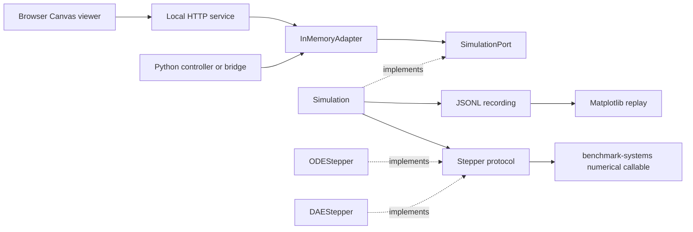

# Package architecture

`bs-simulators` adds live execution and observation to numerical models from
`benchmark-systems`. The model library remains independently usable for
offline numerical simulation, symbolic analysis and Matplotlib animation.
The packages have independent versions; `bs-simulators` 0.1.0 requires
`benchmark-systems>=1.1.2,<2` from PyPI.

## Responsibilities

| Component | Responsibility |
| --- | --- |
| `runtime.core` | Generic Simulation, clock, input retention and controller ownership |
| `runtime.steppers` | Configurable ODE/DAE integration and atomic interval commits |
| `runtime.signals` | Signal descriptions and controller/timestamp validation |
| `runtime.protocols` | Structural `SimulationPort` and `Stepper` interfaces |
| `presets` | Small configurations such as create_pendulum, returning Simulation |
| `comms.adapters` | In-memory reads and complete-vector or named-signal writes |
| `comms.http` | Local HTTP endpoints and browser-resource serving |
| `viewers` | Packaged Canvas viewer resources |
| `benchmark_systems.models` | Numerical plant equations |
| `benchmark_systems.animations` | Offline replay helpers |

The runtime imports numerical models without importing communications or
browser components. Public package exports are loaded on demand. The HTTP
server loads its HTML through `importlib.resources`, so the viewer is available
from an installed wheel as well as a source checkout.

## Data flow

`SimulationPort` is a `typing.Protocol`: engines satisfy it by providing its
methods rather than inheriting a base class. It exposes signal descriptions,
named measurements, snapshots and complete input submission. Reading a
measurement does not advance the plant. The adapter delegates named
measurements to the engine instead of interpreting pendulum state indices.

## Ownership and execution

The simulation worker owns integration and committed state. A controller
submits a complete vector through its fixed `controller_id`; the engine
accepts it only when it matches the explicitly selected `active_controller`.
Selection happens before a run and is not changed automatically.

Input updates are validated and queued atomically. The latest pending command
is frozen for one integration interval, and the last applied value remains
active until another valid command is applied. Acceptance and application
have separate sequence and timing fields. An optional UTC timestamp records
the sender's timestamp without replacing the local monotonic receipt clock.

Network reads and writes belong to adapters outside the physics worker.
Future industrial bridges can map transport addresses to the existing named
signals and input operations. OPC UA and Modbus adapters are not currently
implemented.

## Technology and extension points

The current CLI uses `argparse`; HTTP uses Python's standard library; the
browser scene uses Canvas.

A new plant can provide the same structural interface while exposing its own
signals and measurements. A new viewer can consume snapshots without owning
the simulation clock. These extension points do not imply that additional
browser scenes for every model, higher-index DAE initialization, or industrial
transports are already part of this release. See the [pendulum guide](pendulum.md) for the implemented
experiment and its supported operations.

See [Configure a simulation](simulation.md) for model arguments, signal mapping
and DAE consistency configuration.

Omitting `stepper` creates a fresh RK45 ODE integrator for each simulation.
DAE models require an explicit DAEStepper configuration.
