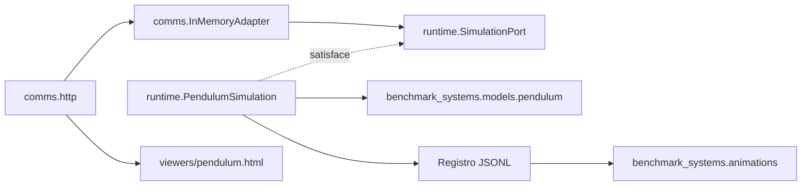

# Extracción desde benchmark-systems

El prototipo se desarrolló sin commits en la rama `develop` de
`benchmark-systems`. Esta extracción crea el paquete complementario
`bs-simulators`, importable como `bs_simulators`, con versión inicial `0.1.0`.
La versión de la librería original permanece en `1.0.7`.

## Responsabilidades

| Ubicación anterior | Ubicación nueva |
| --- | --- |
| `benchmark_systems/simulation/core.py` | `bs_simulators/runtime/core.py` |
| `simulation/protocols.py`, `signals.py` | `runtime/protocols.py`, `runtime/signals.py` |
| `simulation/adapters.py` | `comms/adapters.py` |
| `simulation/server.py` | `comms/http.py` |
| `simulation/viewer.html` | `viewers/pendulum.html` |
| `python -m benchmark_systems.simulation` | `python -m bs_simulators` |
| Ejemplos y pruebas de simulación en vivo | `examples/` y `tests/` de este repositorio |

El motor utiliza `benchmark_systems.models.pendulum` como dependencia externa.
Los modelos numéricos/simbólicos, integradores anteriores y animadores offline
no se trasladan. El replay sigue usando `benchmark_systems.animations`.

`runtime` no importa comunicaciones ni recursos web. Las exportaciones de nivel
superior se cargan de forma diferida para conservar esa separación. HTTP recibe
un motor que satisfaga `SimulationPort` y carga el visor con
`importlib.resources`, también desde un wheel instalado.

## Qué se conserva

Física, entrada congelada por intervalo, retención del último valor válido,
selección explícita del controlador, validación de fechas e instantes de recepción
monotónicos y registro terminal. No se añaden OPC UA/Modbus reales, FastAPI ni
WebSocket durante la extracción.

Se mantiene una copia de seguridad del prototipo de origen antes de retirar sus
archivos. `AGENTS.md` y `.vscode/` del repositorio original no forman parte de la
extracción. Su README enlaza al nuevo proyecto.

## Corrección detectada durante la migración

En Windows, rechazar un POST antes de leer su cuerpo podía cerrar el socket con
datos pendientes: el cliente recibía un reset intermitente en lugar del error
HTTP esperado. El servidor del paquete extraído drena de forma acotada el cuerpo
pendiente antes de responder con error. La espera tiene límite y no afecta al
hilo físico. No se han relajado las pruebas de rechazo.

## Instalación conjunta

Las dependencias de ejecución declaran `benchmark-systems>=1.0.7,<2`. Como
esa versión no está en PyPI, PDM fija su resolución de desarrollo al commit
Git existente `0334ffd8179fa5355236d0aeb00aef42b3280517`, sin cambiar los
requisitos públicos del wheel. No se usa una dependencia editable del núcleo.
El intento inicial de resolver un grupo editable local falló al buscar primero
el requisito por nombre en PyPI; no se ha dejado ese grupo incompleto.
Las distribuciones de ambos paquetes se verifican por separado antes de la
limpieza del origen. Las versiones de cada paquete pueden evolucionar de forma
independiente, conservando un rango de compatibilidad probado.

## Resultado final

El repositorio nuevo usa una `.venv` propia y un lockfile generado por PDM.
Las 45 pruebas del simulador pasan en ese entorno; las 40 pruebas originales
del núcleo pasan después de retirar de él el prototipo. Ambos repositorios
siguen en `develop`, sin commits ni publicaciones durante esta extracción.

Se encontraron dos limitaciones locales de permisos: la carpeta temporal
predeterminada de pytest y la limpieza de directorios de build de solo lectura.
Las pruebas finales usaron una carpeta temporal nueva y la construcción final
usa la opción oficial `-C no-clean-build=true`; no se editan generados a mano.
